# R&B Foods (Pvt.) Ltd. — Master B2B SEO Strategy & Content Playbook

This master strategy document provides the definitive guide for ongoing search engine ranking, content marketing, and technical SEO for **R&B Foods (Pvt.) Ltd.** It is engineered to help future copywriters, marketers, and developers maintain high organic visibility across Google for industrial fruit purees, concentrates, and aseptic ingredients.

---

## 1. Brand Core & Authority Positioning

When writing any blog, press release, or product landing page, always maintain these non-negotiable brand facts:

| Core Pillar | Official Fact (Never Guess or Change) |
| :--- | :--- |
| **Corporate Entity** | R&B Foods (Pvt.) Ltd. |
| **Plant Location** | 8-Km Jhang Road, Shorkot City, District Jhang, Punjab, Pakistan |
| **Core Processing Machinery** | Genuine continuous lines engineered by **BERTUZZI S.r.l. (Milan, Italy)** |
| **Plant Capacity** | 10 Metric Tons / hour continuous throughput |
| **Flagship Variety** | Pakistani Chaunsa Mango Pulp (20°–26° natural Brix, Multan & Shorkot belt) |
| **Standard Export Packaging** | **Strictly 3 Aseptic Steel Drum Formats:**<br>• **210 kg Aseptic Steel Drum:** Single-strength purees (Mango, Peach, Apple, Apricot, Plum, Banana)<br>• **200 kg Aseptic Steel Drum:** Guava Pulp & Strawberry Puree<br>• **220 kg Aseptic Steel Drum:** Concentrates (Chaunsa, Peach) & Tomato Paste (28–30° Brix Cold Break) |
| **Container Stuffing** | 80 Drums per 20ft FCL dry/reefer container (16.0 MT – 17.6 MT Net) |
| **Storage Temperature** | Recommended 4°C – 8°C (Ambient up to 24 Months) |
| **Zero-Tolerance Rules** | **No Bag-in-Box (BIB), No Frozen Puree Pails (-18°C), No Kinnow/Citrus, No Chlorine in fruit washing (clean water immersion only).** |
| **Certifications** | HACCP Certified, Halal Certified |
| **Executive Leadership** | Syed Basit Sultan Bukhari (Chairman), Muhammad Rafique (Chief Executive Officer) |
| **Hotline & Export Desk** | WhatsApp: `+92 334 3734786` &bull; Email: `exports@rbfoods.com.pk` |

---

## 2. Master Keyword Matrix by Search Intent

Target these exact keywords across future blog posts, technical articles, and landing pages:

### Tier 1: High-Volume Commercial Keywords (Procurement Officers & Importers)
- `chaunsa mango pulp exporter pakistan`
- `aseptic fruit puree manufacturer pakistan`
- `industrial mango puree bulk supplier`
- `aseptic chaunsa mango pulp 210kg drum`
- `guava pulp aseptic bulk manufacturer pakistan`
- `tomato paste 28-30 brix cold break pakistan`
- `industrial fruit processing company shorkot`
- `b2b fruit puree supplier FOB karachi`

### Tier 2: Product & Varietal Keywords (Food Formulators & R&D Teams)
- `chaunsa mango concentrate 28-30 brix bulk`
- `sindhri mango pulp single strength`
- `anwar ratool mango puree supplier`
- `summer peach puree aseptic 9 brix`
- `peach concentrate 30-32 brix manufacturer`
- `fresh strawberry puree aseptic 200kg drum`
- `falsa puree aseptic bulk exporter`
- `aseptic banana puree industrial supply`

### Tier 3: Technical Specifications & Engineering (Plant Auditors & QA Managers)
- `bertuzzi italy fruit processing line pakistan`
- `bostwick consistometer flow rate mango pulp`
- `aseptic drum packaging 80 drums per fcl`
- `haccp halal certified fruit pulp factory pakistan`
- `low total plate count tpc fruit puree supplier`
- `htst flash sterilization fruit puree without scorched flavor`

---

## 3. Pillar-and-Cluster Content Architecture (12 Pre-Planned Blog Topics)

To dominate organic search results, publish in **thematic topic clusters**. Each blog must link to its respective pillar page (`/purees`, `/facility`, `/quality`, `/packaging`, or `/rfq`).

```mermaid
graph TD
    Pillar["Pillar: Industrial Fruit Purees (/purees)"]
    
    C1["Cluster 1: Mango Puree Varieties"]
    C2["Cluster 2: Processing Technology"]
    C3["Cluster 3: Packaging & Cold-Chain"]
    C4["Cluster 4: Tomato Paste & Purees"]
    
    Pillar --> C1
    Pillar --> C2
    Pillar --> C3
    Pillar --> C4
    
    C1 --> B1["Blog 1: Chaunsa vs. Alphonso for Beverages"]
    C1 --> B2["Blog 2: Technical Specifications Guide for Chaunsa"]
    C1 --> B3["Blog 3: Sindhri & Desi Mango Blending Rules"]
    
    C2 --> B4["Blog 4: Bertuzzi Italy Flash Sterilization Benefits"]
    C2 --> B5["Blog 5: Bostwick Viscosity & Pectin Control"]
    C2 --> B6["Blog 6: Cold De-Stoning vs. Seed Grinding"]
    
    C3 --> B7["Blog 7: 210kg Aseptic Steel Drum 20ft FCL Guide"]
    C3 --> B8["Blog 8: FOB Karachi vs CIF Jebel Ali Shipping"]
    
    C4 --> B9["Blog 9: Tomato Paste 28-30 Brix Cold Break"]
    C4 --> B10["Blog 10: Guava Pulp 07-12 Brix for Nectars"]
    C4 --> B11["Blog 11: Highland Peach Concentrate Vacuum Evaporation"]
    C4 --> B12["Blog 12: Pakistan 12-Month Fruit Harvest Matrix"]
```



### Ready-to-Write Blog Briefs:

#### Blog 1: "Why Pakistani Chaunsa Mango Pulp Outperforms Indian Alphonso in Industrial Juice Formulations"
- **Primary Keyword:** `chaunsa mango pulp vs alphonso`
- **Secondary Keywords:** `chaunsa mango pulp industrial juice`, `pakistani mango puree high brix`
- **Goal:** Explain why beverage giants prefer Chaunsa’s natural 20°–26° Brix and distinct aromatic esters over Alphonso’s higher acidity.
- **Internal Links:** Link to `/purees` (Chaunsa specs) and `/rfq` (Request samples).

#### Blog 2: "Aseptic Chaunsa Mango Pulp Specifications: A Complete Quality Guide for Beverage Manufacturers"
- **Primary Keyword:** `chaunsa mango pulp specifications`
- **Secondary Keywords:** `bostwick consistometer mango pulp`, `brix acidity ratio mango puree`
- **Goal:** Deep dive into Brix (Min 20°), Bostwick (9–15 cm/30s at 20°C), pH (3.70–4.10), and Acidity (0.50–0.80%).
- **Internal Links:** Link to `/purees` and `/quality` (testing lab).

#### Blog 3: "How Bertuzzi Continuous Flash Pasteurization Preserves Fresh Mango Volatiles Without Scorched Taste"
- **Primary Keyword:** `bertuzzi italy fruit processing line`
- **Secondary Keywords:** `htst flash sterilization fruit pulp`, `aseptic mango processing machinery`
- **Goal:** Showcase the engineering rigor of R&B Foods’ Italian machinery, vacuum de-aeration, and ultra-short residence time.
- **Internal Links:** Link to `/facility` (video tour) and `/about`.

#### Blog 4: "The 210kg Aseptic Steel Drum Standard: Container Loading (80 Drums/FCL) & Shelf Life Stability"
- **Primary Keyword:** `210kg aseptic steel drum fruit puree`
- **Secondary Keywords:** `20ft fcl fruit puree container stuffing`, `aseptic barrier bag drum packaging`
- **Goal:** Logistics breakdown for shipping brokers: gross weight, tare weight, 80 drums per FCL (16.8 MT Net), storage at 4°C–8°C, and 24-month shelf life.
- **Internal Links:** Link to `/packaging` and `/rfq`.

#### Blog 5: "Tomato Paste 28–30° Brix Cold Break: Industrial Processing Standards for Ketchups and Sauces"
- **Primary Keyword:** `tomato paste 28-30 brix cold break pakistan`
- **Secondary Keywords:** `bulk tomato paste 220kg drum`, `bostwick consistency tomato paste`
- **Goal:** Highlight color a/b value Min 1.90, Bostwick 04–07 cm/30s at 12° Brix, Howard mold count Max 40%, and 220kg drum packaging.
- **Internal Links:** Link to `/purees` and `/rfq`.

#### Blog 6: "Aseptic Guava Pulp (07°–12° Brix): The Natural Pectin Body-Builder for Tropical Nectars"
- **Primary Keyword:** `aseptic guava pulp manufacturer pakistan`
- **Secondary Keywords:** `guava pulp 200kg drum`, `vitamin c guava puree`
- **Goal:** White guava pulp’s creamy texture, high natural ascorbic acid (Min 200 ppm), and optimal pH 3.90–4.40.
- **Internal Links:** Link to `/purees` and `/harvest`.

---

## 4. Blog Post On-Page SEO Template & Checklist

When drafting any future article, follow this structured blueprint:

### A. Title Tag & Meta Description Formula
- **Meta Title Formula (Max 60 characters):**  
  `[Primary Keyword] — [B2B Value Proposition] | R&B Foods`  
  *Example:* `Chaunsa Mango Pulp Exporter Pakistan | R&B Foods (Pvt.) Ltd.`
- **Meta Description Formula (145–160 characters):**  
  `[Action Hook] + [Product Specifications] + [Italian Line/Packaging] + [Call to Action]`  
  *Example:* `Source export-grade Aseptic Chaunsa Mango Pulp in 210kg steel drums. 20°–26° natural Brix processed on Bertuzzi (Italy) continuous lines. Request B2B quotation.`

### B. Heading Hierarchy
- **H1:** Exactly 1 per post, contains primary keyword.
- **H2:** Main sub-topics, include secondary keywords and incoterms/specs.
- **H3:** Granular details (e.g. Brix table, Bostwick test, packing breakdown).
- **Paragraphs:** Keep concise (3–4 lines max) for high readability on mobile screens.

### C. Technical Schema Markup (JSON-LD Article Template)
Every blog post should inject this schema in its `<head>` or route layout:

```json
{
  "@context": "https://schema.org",
  "@type": "BlogPosting",
  "headline": "[Blog Title]",
  "description": "[Meta Description]",
  "image": "https://www.rbfoods.com.pk/images/[image-name].jpg",
  "author": {
    "@type": "Organization",
    "name": "R&B Foods (Pvt.) Ltd.",
    "url": "https://www.rbfoods.com.pk"
  },
  "publisher": {
    "@type": "Organization",
    "name": "R&B Foods (Pvt.) Ltd.",
    "logo": {
      "@type": "ImageObject",
      "url": "https://www.rbfoods.com.pk/logos/rb-foods-logo.jpg"
    }
  },
  "datePublished": "2026-11-19",
  "mainEntityOfPage": "https://www.rbfoods.com.pk/blog/[slug]"
}
```

### D. Conversion Elements (Always Include)
1. **Interactive Spec Table:** Always show numerical specs (Brix, pH, Bostwick, Shelf Life).
2. **Direct RFQ Link:** Button linking to `/rfq?product=[Product Name]`.
3. **WhatsApp Hotline Button:** Direct link with pre-filled message:  
   `https://wa.me/923343734786?text=Hello%20R%26B%20Foods,%20I%20am%20inquiring%20about%20[Product]%20export%20pricing`

---

## 5. Ongoing Link-Building & Off-Page SEO Tactics

1. **B2B Directory Listings:**
   - Register verified company profiles on **TradeKey, Alibaba B2B, Kompass, GlobalSources, and Pakistan Trade Portal (Trade Development Authority of Pakistan - TDAP)**.
   - Always ensure NAP (Name, Address, Phone) consistency:  
     `R&B Foods (Pvt.) Ltd. • 8-Km Jhang Road, Shorkot City, Punjab • +92 334 3734786`.
2. **Beverage & Dairy Industry Trade Publications:**
   - Submit press releases and case studies to **FoodBev Media, BeverageDaily, Fruit Processing Magazine, and Tetra Pak Magazine** highlighting the Bertuzzi Italian line installation in Shorkot.
3. **LinkedIn B2B Thought Leadership:**
   - Share plant walkthrough videos, harvest season announcements, and laboratory testing insights targeting Procurement Managers and Food Technologists in the GCC, UK, and European beverage industries.
